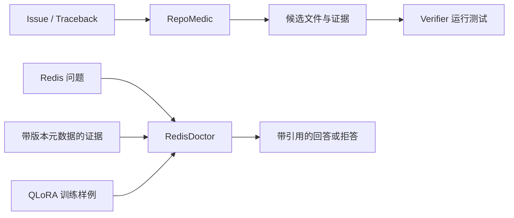

# Agent Systems Lab

包含两个可运行的 AI 系统：RepoMedic 用于处理 Python 仓库故障定位，RedisDoctor 用于提供带版本约束与引用校验的  Redis 技术支持回答。

| 项目 | 解决的问题 | 核心能力 |
| --- | --- | --- |
| [RepoMedic](repomedic/README.md) | 从 Issue、Traceback 与失败测试中定位 Python 仓库的疑似根因 | 多 Agent 分工、受限工具调用、证据聚合、Verifier 实测确认 |
| [RedisDoctor](redisdoctor/README.md) | 在 Redis 版本差异下生成可追溯的技术支持回答 | 版本感知检索、证据约束回答、引用校验、QLoRA 训练与人工评审 |

## 三分钟概览



## 快速开始

本地演示与测试不需要 API Key 或 GPU。

```powershell
python -m venv .venv
.\.venv\Scripts\python.exe -m pip install --upgrade pip
.\.venv\Scripts\python.exe -m pip install -e ".[dev]"
.\.venv\Scripts\python.exe -m unittest discover -s tests -v
```

运行无需外部服务的两个演示：

```powershell
python scripts/replay_repomedic_demo.py docs/demo/repomedic-demo-success.json
powershell -ExecutionPolicy Bypass -File scripts/run_redisdoctor_demo.ps1
```

如需调用外部模型，请从 [`.env.example`](.env.example) 创建本地 `.env`；密钥不会写入代码、日志或仓库。

## 设计与评测

- [项目规格](docs/spec.md)
- [RepoMedic 多 Agent 设计](docs/design/repomedic-complex-multi-agent-v2.md)
- [RepoMedic 演示与工具轨迹](docs/demo/README.md)
- [最终评测摘要与边界](docs/evaluation.md)
- [RedisDoctor QLoRA 训练资产](training/redisdoctor/README.md)
- [脱敏训练与评测样例](examples/redisdoctor/)

### 已验证结论

- RepoMedic 在受控的 Complex-12 故障夹具上，多 Agent Flow 的 Verifier 确认率为 **8/12**，单 Agent 基线为 **1/12**；两者 Top-1 关键文件定位均为 **9/12**。
- RedisDoctor 的版本过滤 RAG 基准上，Recall@5、MRR 与回答准确率均为 **92.86%**，引用约束满足率为 **100%**。这是固定小规模基准，不能外推为通用 Redis 问答能力。
- RedisDoctor 的 Qwen3-4B 4-bit QLoRA + RAG 在 38 个源隔离问题的人工盲评中，将引用支持率从 **68.4%** 提升至 **89.5%**，并将幻觉率从 **18.4%** 降至 **0%**；答案正确率差异未达到统计显著性（McNemar `p = 0.7266`）。

## 范围与边界

- RepoMedic 的外部模型调用是可选路径；默认演示使用本地确定性工具链。
- RedisDoctor 当前实现的是版本过滤与证据校验的 RAG 管线；**未将真实 LightRAG 检索实现作为已完成成果**。
- 公开仓库仅保留脱敏样例、最终配置与汇总结论。原始审核包、运行日志和完整训练数据不属于发布内容。

## 参考与依赖

- RepoMedic 的 Agent/Flow 设计参考 [CrewAI](https://github.com/crewAIInc/crewAI)（MIT）。
- RedisDoctor 预留了 [LightRAG](https://github.com/HKUDS/LightRAG) 接口，但未声明为当前正式实验使用的检索实现。
- QLoRA 训练脚本面向 [LLaMA-Factory](https://github.com/hiyouga/LlamaFactory)（Apache-2.0）。
