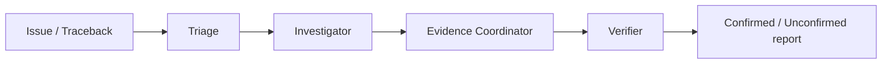

# RepoMedic

RepoMedic 是一个面向 Python 仓库故障定位的多 Agent 诊断工具。输入 Issue、Traceback 或失败测试后，它生成候选根因与文件级证据；只有被 Verifier 通过静态证据或真实测试确认的结论才标记为 `confirmed`。

## 工作流



- **Triage**：判断问题复杂度并选择调查范围。
- **Investigator**：受限地读取源码、搜索符号、查看测试与 Git 历史。
- **Evidence Coordinator**：去重证据，形成文件级候选与待验证假设。
- **Verifier**：仅在候选文件、故障现象与测试之间存在可验证关系时确认结论。

## 运行演示

```powershell
python scripts/replay_repomedic_demo.py docs/demo/repomedic-demo-success.json
```

也可对当前仓库执行本地确定性诊断：

```powershell
python -m repomedic.cli . --issue "RepositoryTools is missing" --json
```

外部模型是可选的。`scripts/run_repomedic_demo.ps1` 会调用 DashScope，需要事先配置环境变量；日志与输出不应包含密钥。

## 评测

在受控的 Complex-12 合成故障夹具上，多 Agent Flow 的 Verifier 确认率为 8/12，单 Agent 基线为 1/12；两者的 Top-1 关键文件定位均为 9/12。该实验说明多 Agent 设计改善了复杂案例中的证据闭环，不代表真实生产仓库的总体修复能力。完整结果与限制见 [评测摘要](../docs/evaluation.md)。

## 安全边界

- 工具只允许在目标仓库范围内读取与运行命令。
- 未经 Verifier 确认的假设不得作为修复结论。
- 运行命令、网络调用和模型调用都受到参数及超时限制。
